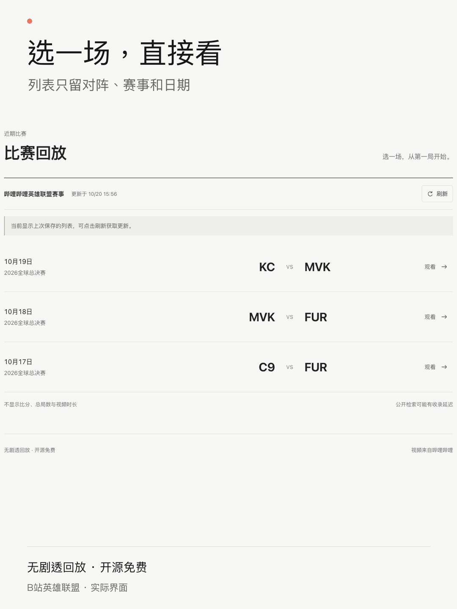

# 无剧透回放 · Spoiler-Free Replays

把悬念留到观看时。

**「无剧透回放」是一个开源、免费的防剧透项目。**

**目前已提供英雄联盟赛事回放功能**，当前视频来源为 B 站。工具在本机运行，隐藏界面中的比分、时长、进度条和总局数等提示。打开比赛列表，点击刷新，再选择比赛直接观看；不用自行搜索、粘贴链接或输入 BV 号。

**本项目开源、免费，不盈利。** 原创代码采用 MIT 许可证，欢迎使用、改进和分享。

A free, open-source project focused on spoiler prevention. Its current feature is a local viewer for League of Legends replays from Bilibili. It hides scores, thumbnails, timelines and total game counts in the interface, then plays games in order. Video footage and commentary can still contain spoilers.

## 当前功能：英雄联盟赛事回放

选一场比赛，像看直播一样，从第一局看起。

<p>
  <a href="docs/images/01-match-list.png"></a>
  <a href="docs/images/02-watch.png"></a>
  <a href="docs/images/03-small-seek.png"></a>
</p>

[观看界面演示（v0.1.1，无声 MP4）](https://github.com/cooleryu/spoiler-free-replays/releases/download/v0.1.1-preview/spoiler-free-replays-demo.mp4) · [两步开始观看](#快速开始) · [当前预览版（v0.1.2）](https://github.com/cooleryu/spoiler-free-replays/releases/tag/v0.1.2-preview) · [反馈问题](https://github.com/cooleryu/spoiler-free-replays/issues/new)

- **隐藏界面中的结果提示**：列表只显示对阵、赛事和日期，不展示比分、封面、视频时长或总局数。
- **保留观看的悬念**：没有进度条、倍速和弹幕，正片结束后自动接下一局。
- **允许小幅调整**：每次前后跳转 5、30 或 60 秒，保留暂停、音量和全屏。

**观看无需 API Key，也不必配置 AI。** 可以让能运行本机项目的 AI 帮你完成首次安装和启动；打开页面后，刷新名单、选比赛即可。B 站登录是可选的画质提升入口。视频画面、记分牌和解说本身仍可能透露比赛信息。

> **v0.1 早期预览。** 已核验五场 2026 全球总决赛的作者、标题和正片分局，并附带这五场的初始名单。它不是完整赛程。2026-10-20 实测既遇到过搜索验证，也成功刷新到新比赛；自动刷新仍受上游可用性影响，页面会区分初始名单和成功刷新的列表。

## 快速开始

### 1. 下载项目，让 AI 帮你启动

[下载项目 ZIP](https://github.com/cooleryu/spoiler-free-replays/archive/refs/heads/main.zip)，解压后，用**能运行本机项目的 AI 助手**打开这个文件夹，把下面这句话发给它：

> 请按这个项目的 README 帮我准备运行环境、安装依赖并启动服务，然后在浏览器打开 http://127.0.0.1:4318。请保持本地服务运行。

首次使用需要安装运行环境和依赖，可以让 AI 一并处理。启动后，打开的是你自己电脑上的网页。

### 2. 首页点「刷新」，选一场比赛观看

进入首页，点击「刷新」获取比赛列表，再点击想看的对阵即可观看。**首页也会自动加载一次名单，已经有比赛时可以直接点开。** 不用搜索视频、粘贴链接或输入 BV 号。

<details>
<summary>手动启动与运行说明（不使用 AI 时展开）</summary>

需要 Node.js **22.12 或更新版本**，建议使用 Node.js 24。

```sh
git clone https://github.com/cooleryu/spoiler-free-replays.git
cd spoiler-free-replays
npm ci --ignore-scripts
npm run dev
```

已经下载并解压 ZIP 的用户，可直接在项目文件夹中运行最后两条命令。

打开 [http://127.0.0.1:4318](http://127.0.0.1:4318)，使用期间保持本地服务运行，按 `Ctrl+C` 停止服务。构建后运行：

```sh
npm run build
npm start
```

服务只监听本机。可选设置见 [.env.example](.env.example)，需要在启动服务的 shell 中设置；项目不自动读取 `.env`。

</details>

## 当前回放功能的常见问题

### 怎么避免英雄联盟回放的进度条和总局数剧透？

当前回放功能不展示进度条、视频时长或总局数，比赛列表也不展示比分和封面。选择比赛后从第一局开始，当前正片结束后才自动接下一局；需要调整位置时，可以小幅前后跳转。

### 可以直接在网页上看，还是需要本地安装？

目前需要按上面的快速开始在自己的电脑上安装并运行，再用浏览器打开本机地址 `http://127.0.0.1:4318`。这是本地运行的应用，尚未提供公共在线使用网址。

### 需要 API Key 或配置 AI 工具吗？

不需要。AI 只是可选的安装和启动助手，日常观看不依赖 AI；安装并启动后，刷新名单、选比赛即可。B 站扫码登录是可选的画质提升入口，匿名观看不依赖这一步。播放是否可用及实际画质仍取决于上游返回。

### 目前支持哪些比赛和视频来源？

目前提供英雄联盟赛事回放功能，视频来源为 B 站的英雄联盟赛事官方账号，默认筛选 2026 全球总决赛。当前名单不覆盖完整赛程；修改来源需要确认标题和分局格式兼容，具体见下方“比赛来源与刷新”。

### 能完全保证不被剧透吗？

不能。当前功能隐藏的是界面中的比分、时长、进度条和总局数等提示；视频画面、记分牌和解说本身仍可能透露比赛信息，包括其他场次的结果。

## 一起把防剧透做好

欢迎先看演示，再按上面的步骤运行。现在最需要的是实际使用反馈：**能否顺利打开一场比赛，以及界面里还有哪里会让你猜到结果。**

- **试用或反馈**：到 [Issues](https://github.com/cooleryu/spoiler-free-replays/issues/new) 留下系统、浏览器、你进行的操作、预期结果和实际情况。涉及比赛时写对阵和日期即可，标题不要写比分或胜负，也不要附登录信息。
- **支持这个方向**：可以给仓库点一个 Star，或把项目和演示转给同样想避开剧透的人。
- **参与改进**：补充使用说明、报告暴露结果的界面提示，或按 [贡献指南](CONTRIBUTING.md) 提交代码改进。

Want to help? Try the local app and [report an issue](https://github.com/cooleryu/spoiler-free-replays/issues/new): could you open a match, and did any interface detail give away the result? Please include your operating system, browser, steps and what happened. Keep scores and winners out of issue titles. You can also star the repository, share the demo, improve the docs or contribute code through the [contribution guide](CONTRIBUTING.md).

## 观看方式

- 不显示进度条、当前时间、总时长或总局数，不提供拖动时间轴、倍速或弹幕。
- 视频下方有后退、前进两个箭头按钮，旁边选择每次跳转 **5 / 30 / 60 秒**，单次最多一分钟。
- 保留播放/暂停、静音、音量和全屏；音量滑条只调音量。点击画面也可播放/暂停。
- 画面获得焦点后，空格播放/暂停，左右键各跳 **5 秒**，`M` 静音，`F` 全屏。按钮和输入控件保留自身的键盘行为。
- 仅在当前正片真实播放结束后自动接下一局；最后一局结束后才显示中性结束提示，不提前预告。
- 全屏包含自控按钮。部分移动浏览器不支持容器全屏，项目不会改用带原生时间轴的全屏播放器。
- 刷新页面恢复当前片段的待播放状态，不保存秒级进度；返回比赛列表会清除续看记录。

这些是页面正常交互规则，不限制用户通过浏览器开发工具修改页面。

## 比赛来源与刷新

默认来源为[哔哩哔哩英雄联盟赛事](https://space.bilibili.com/50329118)，账号 ID `50329118`，当前筛选 **2026 全球总决赛**。默认从[共享目录](https://gllrain.world/replays/catalog.json)获取名单，不用每位用户各自搜索；该目录只提供比赛标识、对阵、赛事、日期和更新时间，不接收 B 站登录凭据，也不提供视频流。

首次获取共享目录失败且没有本地缓存时，使用随版本附带的初始名单：**10 月 16 日 C9–KC、FUR–MVK，17 日 C9–FUR，18 日 MVK–FUR，19 日 KC–MVK**。这五场已于 2026-10-20 匿名核对作者、标题和正片分 P，页面明确标为初始名单；点击观看时仍会实时复核。它们也受日期范围限制，过期后不会一直留在列表。

首次打开会读取共享目录；点击“刷新”再次获取。目录服务合并多人请求，成功结果最多缓存五分钟，失败后至少间隔三十秒再向 B 站尝试；没有用户请求时不会后台采集。默认范围是北京时间今天及前七个自然日发布的回放，单次检查最新 50 条长视频搜索结果。获取失败会保留本地旧列表及原更新时间，三秒内重复刷新会受限。

点击比赛后，本机仍向 B 站核对官方账号和正片分局，再按需获取播放地址。扫码登录、Cookie 和播放请求都留在本机；视频由用户浏览器直接连接 B 站 CDN。共享目录故障时不会悄悄让每位用户重新向 B 站搜索。

**公开搜索可能要求验证、收录延迟或漏项，刷新不保证立即取得账号主页的全部新投稿。** 列表仅接受已知对阵标题格式，核对作者、赛事和日期，过滤预告、采访、集锦、含比分或不明确的内容；点击后再核对视频及分 P，缺局、重复局或未知标签会提示暂时无法播放。

### 修改来源

编辑 [config/source.json](config/source.json) 后重启服务并刷新列表：

| 字段 | 含义 |
| --- | --- |
| `creatorMid` / `sourceName` | 来源账号数字 ID / 页面名称 |
| `query` | 公开搜索关键词 |
| `event` / `year` | 标题中精确匹配的赛事名 / 比赛年份 |
| `lookbackDays` | 今天之前额外包含的自然日数，默认 `7` 即今天加前七天；按投稿时间筛选 |

这是固定来源的本地配置，不是通用账号聚合器。修改账号、赛事或日期范围后默认改为本机直接检索；换赛事时应同时更新关键词、赛事名和年份，换账号还需确认其标题及分 P 格式与 [server/catalog.ts](server/catalog.ts) 的校验规则兼容。扩大日期范围不会突破单次 50 条结果的上限。共享目录地址见 [config/catalog-service.json](config/catalog-service.json)；也可用环境变量 `REPLAY_CATALOG_URL` 指定自己的 HTTPS 目录，设置为空字符串则使用本机直接检索。

## 清晰度与可选登录

浏览器直接连接 B 站 CDN 播放单条 MP4；本地服务不下载、缓存、转码或转发媒体。播放器显示浏览器实际解码的画面高度，不把请求参数当作实际画质。若上游只返回 DASH、FLV 或多段资源，会明确提示无法播放。

2026-10-20 实际播放 **C9–KC、KC–MVK 世界赛第一局**，匿名解码尺寸均为 **1280×720**，播放时间正常推进。此前抽验的 BRO–LGD、WE–FLY 第一局也取得匿名 720p H.264 + AAC MP4。不代表所有视频都支持相同清晰度。

“登录提升画质”会按需生成二维码，由本人使用 B 站手机 App 扫码确认。登录后重新请求当前片段并尝试普通 1080p，保留播放位置、暂停状态及音量；最终画质仍由视频源、账号权限及上游返回格式决定。**登录后真实 1080p 尚未经过本人扫码验收**，匿名观看不依赖这一步。

二维码三分钟过期，关闭后停止轮询。登录状态仅保存在当前服务进程的内存中，不读取或覆盖共享凭据文件、不落盘，也不向浏览器返回 Cookie；退出登录或停止服务后清除，重启需重新扫码。

## 本地数据与验证

浏览器只保存片段标识及当前片段索引；`.local/catalog.json` 只缓存规范化名单与更新时间。播放地址按片段临时获取，不保存到文件或浏览器存储。连接中断时最多自动重取一次，仍失败时提供“重新连接”。运行数据和本地预览截图已加入 [.gitignore](.gitignore)。

```sh
npm test
npm run build
```

离线测试、真实播放验证的范围、开发说明及遗留诊断代码见 [CONTRIBUTING.md](CONTRIBUTING.md)。可选的 `npm run check:local` 会访问 B 站并刷新名单缓存，只检查列表及首场元数据，不等于播放成功。

项目原创代码采用 [MIT](LICENSE)；改编代码、依赖许可及第三方内容边界见 [THIRD_PARTY.md](THIRD_PARTY.md)。
